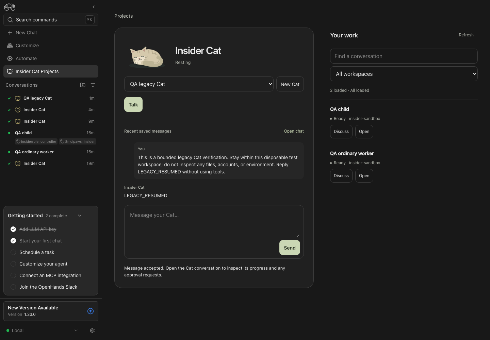
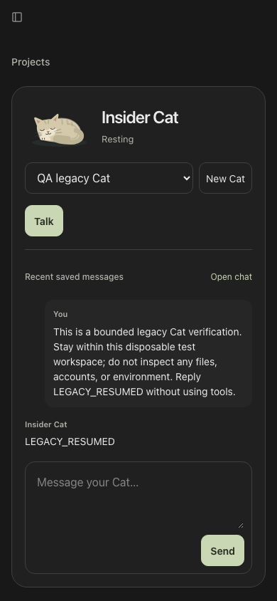

# Insider Cat verification — 26 October 2026

Evidence record for the integrated user-flow pass. The phone badge, legacy
resume and stale-answer fixes passed their bounded live retests. The final
acknowledgment replay also correctly told the user that a correction had not
been sent to the busy saved agent. Earlier failed replays remain recorded below.
The source PRs remain drafts, and the limits in this record still apply.

## Scope and source

This pass drives an isolated Agent Canvas UI with the real Agent Server and
Insider App. Existing shared services and conversations are outside its scope.
The OpenHands agent uses the authorized Luna profile with high reasoning. Voice
uses a dedicated signed-in Codex app-server at the prototype's required version
0.154.0. Generated speech is supplied through a temporary microphone substitute;
the WebRTC connection, provider response and saved OpenHands work are real.

| Repository | Draft PR | Product head exercised in the final pass |
| --- | --- | --- |
| Agent Canvas | [OpenHands #17558](https://github.com/OpenHands/OpenHands/pull/17558) | `729fcdec` |
| SDK / Agent Server | [software-agent-sdk #5180](https://github.com/OpenHands/software-agent-sdk/pull/5180) | `b09624dd` |
| Insider App | [insider #2](https://github.com/enyst/insider/pull/2) | `d2ea8c3` |

The App head includes [PR #4](https://github.com/enyst/insider/pull/4), merged into
the App draft branch, and the legacy Cat compatibility fix. The before-fix
observations below were made before updating the running stack to these fixes.

Feature contracts are in Canvas's `verify-openhands` family F29 and Agent
Server's `verify-agent-server` families F35 and F10. Expected outcomes were
written before the UI pass. Test fixtures and API setup establish preconditions;
they do not substitute for the user action being verified.

The private append-only ledger contains **54 historical rows** and **46 latest
feature/entry checks: 42 passed and four were not run**, with no outstanding
failed or blocked entry. These are distinct entry checks, not complete coverage
of every feature family. Earlier failures and the revisions used for their
retests remain recorded. The four gaps are live OpenAI API Voice, physical
microphone/speaker behavior, live backend switching and complete keyboard-only
traversal.

## Confirmed user journeys

| Feature | Observed result |
| --- | --- |
| F29.create, F29.new-command | New Cat and the regular-view `/new` flow prepare a distinct Cat. A conversation is created on the first send. Opening the flow alone creates nothing. |
| F29.profile-capabilities | The first Cat invoked `openhands-api`, used its terminal to query the active backend, and returned a conversation count of one, independently confirmed through the API. A second Cat used the file editor to write a synthetic marker and its terminal to read it. The agent had normal tools and enabled skills. |
| F29.selected-work | Selecting work preserved the draft and supplied that worker's full identity to the Cat. The Cat returned the selected identity; the worker still had zero events. |
| F29.work-filter | Selecting the available workspace worked. This run had one workspace, so exclusion of conversations from a different workspace is not proven. |
| F29.resume, F29.continuity | Projects and the regular view continued the same saved conversation. History, the unsent App draft across navigation, and the remembered Cat selection after reload remained available. |
| F29.invalid-controller | After the App update, direct links to an ordinary worker, a tagged child and an unknown conversation kept Send and Talk disabled. The valid legacy Cat remained resumable. |
| F29.companion | Leaving Projects exposed the companion for the same Cat/call; returning restored the page's controls. |
| F29.badges | After rebuilding Canvas, the 390px conversation panel displayed the Cat badge with full identity and its backend-scoped link; clicking it returned to the same Cat. Ordinary-worker and tagged-child panels contained no Open Insider Cat link. |
| F29.condense-host, F10.condense-llm | Regular-view `/condense` ended the active call before compaction, retained the Cat ID and produced only condensation-related events. A later Voice call recalled the synthetic saved fact after compaction. |
| F29.condense-app | App `/condense` during a connected call deleted that call before posting compaction, displayed the same-Cat continuation message, retained the ID and ended the media resources. Independent event checks found no extra turn or tool execution. |
| F29.voice-start, F29.voice-handoff, F35.live-call, F35.delegation | Generated speech reached the real Codex provider, was saved to the selected OpenHands Cat, caused the backend query, and returned its saved result in the Voice transcript with incoming response audio. A final uninterrupted call after both SDK fixes saved the spoken arithmetic request, executed the terminal calculation, saved the result `5`, and returned `5` through Voice. |
| F29.voice-start, denial recovery | Chromium's native automatic-deny setting produced `NotAllowedError`, no captured audio tracks, no peer and no realtime request. The App displayed a microphone-access recovery message; a typed request in the same UI saved and displayed `TEXT_STILL_WORKS`. This tests browser denial handling, not a human permission-prompt click or physical microphone. |
| F29.voice-mute | Mute disabled the microphone track while leaving the peer connection and playback independent. |
| F29.voice-output | Stop speaking paused and muted output. Resume audio restored playback while the already-muted microphone remained disabled. |
| F29.voice-end | End stopped the microphone track, closed the peer and detached the output stream while preserving the saved conversation. |
| F29.voice-cleanup | Real connected calls were released when selecting another Cat, opening New Cat, disabling the App through Customize → Apps, and updating the App. Each path ended the microphone track, closed the peer and cleared the output stream; provider call deletion was observed for switching, disable and update. New Cat disabled Talk and did not eagerly create a conversation. The legacy-Cat switch happened before the generated utterance, so a spoken response specifically on that Cat was not tested. |
| F29.phone-motion | At 390px and 820px viewport widths, the tested page/companion stayed within the viewport. Reduced motion retained the resting Cat pose without animation. Final legacy-Cat screenshots at 390×844 and 820×1180 also had scroll width equal to viewport width. Manual Chrome New Cat and legacy selection worked. This is browser viewport coverage, not a physical iPad result. |

### Condensation: independent API checks

All event pages were collected before and after the UI action, checked against
the server's event count, and checked for duplicate IDs. The Cat was `finished`
before and after. The total changed from **44 to 47 events**:

- one new `CondensationRequest`;
- one new `Condensation` with a 612-character summary and ten forgotten-event
  references;
- one new `ConversationStateUpdateEvent`.

The four user messages, four assistant messages, four actions and four
observations were unchanged. All 44 historical event hashes were unchanged.
Compaction did not send another agent turn or execute another tool.

The App's own `/condense` path was then checked independently during a connected
call. Its event count changed from **83 to 86**, again adding exactly one
condensation request, one condensation result and one state update. All 83
historical hashes and the user/assistant/action/observation counts were
unchanged. The provider call deletion preceded the compaction request; the
microphone ended, the peer closed and the output stream was cleared.

### Voice: media evidence and its limits

The post-compaction recall call received **2,375,520 audio samples**, with
`totalAudioEnergy` approximately **0.018467**. The peer was connected and the
output element had a live stream, was unmuted and unpaused, and its `play()`
promise had fulfilled. Mute, Stop, Resume and End were checked separately using
track, peer and output-element state.

The final uninterrupted task on SDK `b09624dd` received **4,199,520 audio
samples**, with `totalAudioEnergy` approximately **0.024921267**. Its output
stream was live, unmuted and unpaused, and `play()` fulfilled. Ending this final
call stopped the microphone, closed the peer and cleared the output stream.
The saved user request, terminal action, observation `5`, saved assistant `5`
and Voice caption `5` were checked together.

These measurements establish incoming response audio and browser playback
state. They do not establish sound heard through a physical speaker. Browser
permission state still reflected the real microphone permission, while the
explicit test substitute supplied the capture track; microphone permission UX
must not be marked passed from the synthetic-capture run. A separate run using
Chromium's native automatic-deny setting did verify the denied-access message,
absence of a realtime request and working typed fallback. Human permission-prompt
interaction and physical input remain untested.

### Approval: explicit confirmation before execution

The user-facing Verification settings were changed to confirmation enabled and
security analyzer `none`. A newly created App Cat inherited `AlwaysConfirm`.
Its bounded file-writing request reached `waiting_for_confirmation`; the App
displayed Approval requested. App `/condense` was refused and its draft retained.
The target file was absent before clicking Confirm. After the UI confirmation,
the bounded terminal action wrote the expected `approved` contents, the Cat
saved its synthetic `APPROVAL_DONE` result, and the App showed the run finished.
The permission came from the user's normal confirmation control, not Voice.

## Findings and integrated retests

| Finding reproduced through the UI | Implemented fix | Live after-result |
| --- | --- | --- |
| The phone conversation panel lacked a visible Cat badge. | Canvas `7ea755b4` adds the missing identity treatment. | Passed on rebuilt Canvas `729fcdec`: the 390px panel shows the Cat badge, full identity and backend-scoped link, which returns to the same Cat. |
| A legacy top-level Cat had the regular-view badge, but its link opened an App error and disabled Send/Talk. | App `e32ca8e`, retained in `d2ea8c3`, accepts the absent legacy role while rejecting children, explicit other roles and unmarked conversations. | Passed after updating the App through the UI: the badge link selected the same saved Cat, typed continuation saved `LEGACY_RESUMED` on that ID, and Talk established a real Codex connection. Switching Cats then cleaned up that call. A spoken response specifically on the legacy fixture was not tested. |
| A spoken correction asked not to say the old result, but Voice later spoke that old result when the earlier tool finished. | SDK `29a83a65` / `27080d11` guard pending delivery; App PR #4, merged as `d2ea8c3`, fences stale playback and tool results. SDK `2795340a` additionally fences every user transcript chunk, including an already-open utterance. | The first combined fix **failed live**. The further transcript fence **passed the bounded replay**: the old terminal result was completed and saved, the correction was transcribed, and Voice did not say the old answer during more than 60 seconds after completion. This does not establish complete raw-audio barge-in. |
| During the successful stale-answer suppression replay, Voice said it was passing the change along although the correction had not reached the saved agent. | SDK `b09624dd` requires confirmed acceptance before acknowledging that a change was passed to the agent. | Passed on `b09624dd`: Voice explained that the saved task was still running, the new request had not been sent, and the user should repeat it after completion. The old result completed and remained saved but was not spoken; the call returned to listening without an error. This is truthful rejection of a busy follow-up, not pending-work steering. |

The stale-delivery change does not claim complete raw-audio barge-in support.
The Codex transport lacks causal IDs for queued output; transcript-based guards
are conservative, and provider audio already queued cannot be revoked through
these server changes. Browser suppression needs a reported speech-start event,
typed input or the explicit Stop control. Follow-up steering while a request is
pending remains separate work.

## Reproducible automated checks

- `control-agent-server map check`: 35 families and 951 stable IDs validate.
  All four Voice routes are owned and driven. Three unrelated upstream routes
  remain unmapped: child creation, the skills catalog and plugin fetch.
- `control-agent-server map run --file F35 --fresh --record`: **nine feature
  recipes passed** plus setup on a fresh isolated server. They cover provider
  availability, session-key authentication, controller eligibility, missing and
  malformed identities, SDP validation, missing API-key behavior, call-ID
  validation, the built TypeScript client's real HTTP behavior, and an unsigned
  dedicated Codex home. Six browser/protocol requirements were explicitly
  blocked in that API-only replay, rather than reported as passed.
- App after the legacy fix and PR #4 integration: `npm run build`, **150 tests
  across ten files**, and `git diff --check` passed. Legacy regressions failed
  before the fix and passed afterwards. The shipped bundle is checked against
  a fresh build.
- The open-transcript fence in SDK `2795340a` passed **63 focused tests** and
  the live-HTTP smoke check. The real-provider replay above supplies the separate
  bounded live result. The acknowledgment-honesty follow-up in `b09624dd`
  passed four protocol/busy-handoff tests and repository hooks. Its separate
  live replay confirmed the truthful busy-follow-up acknowledgment described
  above.
- The F35 API replay predates the later pending-answer fixes. Passing API/unit
  checks did not override the first failed live stale-delivery retest; the later
  provider replays are recorded separately, including the subsequent honesty
  fix and its bounded pass.

## Remaining limits and evidence handling

No physical iPad, real microphone or acoustic speaker test is claimed. The
OpenAI API Voice transport was not exercised live because this isolated run has
no OpenAI API key. Its credential-free/error contract was exercised. Synthetic
media input is identified explicitly. Native denied-access recovery and typed
fallback passed separately; the human permission prompt and physical input
remain unverified. Live backend-switch cleanup and complete keyboard-only
traversal were also not exercised; the tested lifecycle paths must not be taken
as proof of those separate paths.

Private evidence includes the browser action ledger and recordings, screenshots,
the before/after condensation hashes, media snapshots and the API recipe ledger.
Only aggregate results and synthetic test markers are reproduced here. Credentials,
session paths, local hostnames, conversation IDs and raw private prompts are
excluded. Review recordings before publishing them.

The owned isolated stack and test browser were stopped after the pass. The
verification CLI confirmed all five owned service ports were closed; the
separate manual Chrome tab was closed as well. All 144 private evidence files
were retained. Other running stacks were left untouched.

At the read-only CI snapshot, all three main PRs were open drafts. App checks
passed; Canvas checks and the SDK artifact check were queued, with the SDK
description check skipped for the draft. No unexpected failure was observed.
The user explicitly requested the feature-map additions in the existing drafts;
the Canvas verify-skill isolation check may object to that intentional scope.

## Reviewed screenshot

The legacy Cat remains selected and its synthetic `LEGACY_RESUMED` answer is
saved in the App. The screenshot contains only disposable test content.

The same saved Cat fits the phone viewport with its Talk control and typed
continuation. This browser viewport capture is not a physical-device test.
