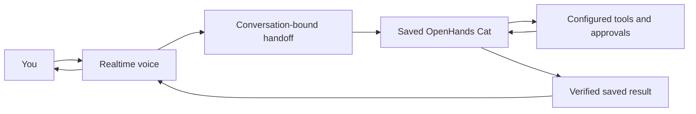

# Insider Cat

A Cat-first Projects page and a durable companion for **Agent Canvas**. Insider Cat
is a sibling of SmolPaws, with its own conversation and the capabilities supplied
by its configured agent profile.

This repository includes the prepared browser bundle, source, skill,
translations, and tests. Building or installing it does not require Odie's source
checkout.

The development branch `gpt/insider-voice-discovery` holds the 0.2.0-beta.1 **Projects**
release, App PRs [#5](https://github.com/enyst/insider/pull/5) through
[#27](https://github.com/enyst/insider/pull/27), paired with
[Canvas #19495](https://github.com/OpenHands/OpenHands/pull/19495)
and [Agent Server #5180](https://github.com/OpenHands/software-agent-sdk/pull/5180).
Projects (conversation sender, reactions, resolved state, the `ask` tag, and
coordinator message copies) come from
[Agent Server #6602](https://github.com/OpenHands/software-agent-sdk/pull/6602).
Voice sends spoken requests through the Agent Server's idle-only
`POST .../voice/messages` from [#5180](https://github.com/OpenHands/software-agent-sdk/pull/5180);
an Agent Server without it refuses to send them.
See [CHANGELOG.md](CHANGELOG.md) for the release notes. The release remains a
draft; `main` does not yet contain the companion and Voice behavior described
below. Install the reviewed feature branch or a pinned commit with compatible
Canvas and Agent Server builds.

## Install in Canvas

Open **Customize → Apps → Add app** and enter:

| Field      | Value                                                  |
| ---------- | ------------------------------------------------------ |
| App source | `github:enyst/insider`                                   |
| Ref        | `gpt/insider-voice-discovery`, or a reviewed commit SHA   |
| Path       | Leave empty                                            |

Installation starts disabled. Review and enable **Insider Cat**, then open
**Projects** at `/extensions/insider-cat/projects`.

Use a local Agent Server connection with the Apps endpoints and profile launch
additions available. Canvas Apps do not currently support cloud backends. Apps
run as trusted code inside Canvas and use authenticated requests to their owning
backend.

For local development, App source can instead be the absolute directory of this
repository on the **Agent Server machine**. Leave Ref and Path empty.
The backend copies the prepared `extension.js`; it does not install npm
dependencies or run a build.

## What it does

- Put the Cat, its messages, and **Talk** at the center of the page. The SVG Cat
  rests, wakes, listens, speaks, and works as its state changes. Conversation
  browsing sits under **Your work**; the page has one set of voice controls.
  Reduced motion is supported, and errors and approval requests remain visible
  as text alongside the Cat's pose. The App follows light Canvas themes such as
  Paper and keeps its dark palette on dark themes.
- Browse conversations with workspace and title/ID filters, manual refresh, and
  explicit pagination. Filters apply to loaded conversations; the page shows its
  coverage. Approval requests, errors, paused work, and ended runs have distinct
  labels. An ended run is not a claim that a task succeeded.
- Group loaded work by what it needs from you: **Needs you** (approval
  requests, paused, errors, stuck), **Working**, **Finished, ready to check**,
  **Idle**, which starts collapsed, and **Other** for any other state. Once a
  Cat is chosen, **This Cat's work** narrows the list to conversations tracked by that Cat: workers it tagged
  with `insidercat`, ones you added with **Track with Cat**, and its own
  sub-conversations. Tracking only edits tags; it never messages the work.
- **Resolve** marks work as done with the shared `resolved: user` tag;
  **Reopen** removes it. Resolved work moves to a collapsed **Resolved** group
  unless it needs you again (approval, paused, error, stuck) or is running
  again. Agent Server
  Projects may also set `resolved: auto` from a server-side check.
- **Project files** appear under the work list when the chosen Cat is the
  coordinator of an Agent Server project. Files you add with **Add file** are
  marked "Added by you", and files an agent saved with `save_project_artifact`
  are marked "Made by an agent", with the conversation that saved them. Text
  files (Markdown, text, JSON, CSV, YAML and similar) open in a preview; other
  types are listed without one. The section stays hidden on servers without
  Projects.
- When the Cat names a conversation by its ID, its message shows a live card
  with the title, status and last update; selecting it opens the conversation.
  Up to six named conversations are re-read on each history refresh.
- Select work using its full conversation ID without replacing your draft.
  Opening a conversation stays inside Canvas.
- One Cat per project. A Cat's window shows only that project; **All
  projects** returns to the project list, which names each project and offers
  **New project**. Saved Cats are discovered across all conversation-list
  pages; a single one resumes automatically. **New project** creates a separate
  Cat on the first send.
  The App remembers the last chosen controller for its backend and organization,
  then verifies its Insider tags when loading it again. `/new` prepares a fresh
  Cat without sending that command to the previous conversation. Controllers
  must be top-level conversations tagged `smolpaws: insider`, with
  `insiderrole: controller` or no role tag for older Cats. Legacy Cats keep
  their saved identity when resumed, including for Voice. Children and
  explicit other roles are excluded. New Cats receive both controller tags.
- Create the controller using the active **OpenHands agent profile** and its
  workspace, preserving the user's confirmation policy and security settings.
  The [Insider skill](skills/insider-cat/SKILL.md) is embedded in its launch
  instructions without changing the stored profile.
- New Cats run on the Agent Server host. On a backend offering both local and
  Docker runtimes, choose a saved host workspace for the Cat; add one in Canvas
  and refresh if needed. Selecting a Docker worker keeps its ID and context but
  does not copy its container's `/workspace` into the Cat's workspace. The App
  explicitly selects the local runtime. Docker-only backends cannot create a
  new Cat; if runtime verification fails, check the backend, refresh, and retry.
  The draft stays intact. Existing Cat selection and Voice resume are unchanged.
- Continue the controller through the normal conversation API. Messages and
  replies are saved on Agent Server. The panel displays text from the latest 50
  events and links to the full conversation for older history, tools, and
  approval controls.
- `/condense` condenses the selected controller without changing its identity or
  starting another agent turn. Resolve running work or approval requests first.
  Requesting compaction from the App or the updated regular Canvas view ends
  that Cat's active voice call, even if compaction later fails. Click **Talk**
  after it completes to load the current context. Opening the full Cat
  conversation and returning to its App page keeps the same conversation ID.
  Automatic call cleanup for regular-view compaction requires the host's
  `onConversationContextChangeRequested` capability. Without it, end voice
  before compacting in the regular view and restart afterwards.
- Messages from other conversations are folded into labelled rows with a live
  card for the sender: a message another conversation sent, a coordinator's
  `[Update from ...]` report, and the person's copied message or a worker's
  reply from a project conversation. A copied person message reads "You, in
  another conversation"; the rest read "Another conversation".
- Emoji reactions appear as chips under the message they target, with the emoji
  and who reacted as the accessible label and tooltip.
- A conversation that ended its turn on a question (`turn=asked`) groups under
  **Needs you** and shows the question on its card, so you see what it needs
  without opening it.

Selecting a worker provides context to the Cat; it does not send that worker a
message. Coordination depends on the tools supplied by the chosen profile. This
App adds no worker dispatcher, scheduler, or shared SmolPaws memory; the
skill asks the Cat to tag workers it starts so the page can track them, to
delegate substantial work to those conversations, and to open each written
message by naming itself and noting that it approves nothing.

Drafts survive navigation while the App remains active. They are not saved
across browser reloads, App disablement, or backend switches. If a send has an
uncertain outcome, inspect the saved conversation before sending again. Leaving
the page stops its history polling without cancelling work already accepted by
the server. Away from Projects, the companion checks the Cat's status every
2.5 seconds while running, or every 10 seconds otherwise.

## Voice

The realtime model listens and speaks. The **saved OpenHands Cat** owns the
conversation, reasons about requests, and runs the tools configured for that
agent. Its ID stays the same when you switch between Voice and typed chat.



Conceptually the handoff is `ask_agent(request)`. The OpenAI API transport calls
it `send_to_insider`; the Codex transport receives `handoff_request` and dispatches
it directly on the server. This is not another tool the saved Cat needs to call:
it is already the agent receiving the delegated request. Do not wire task
execution to the SDK's similarly named `/ask_agent` endpoint: that endpoint asks
a stateless question without saving a turn or running the normal agent loop.

**Tools are a separate requirement.** A real OpenHands agent can have an empty
workspace tool list and only built-in utilities such as `think`, `switch_llm`,
and `finish`. Switching an LLM profile changes its model, not its tools. Choosing
an agent profile for new conversations does not retrofit an existing Cat. Inspect
the saved conversation's actual configuration when diagnosing missing tools.

The Cat should have the normal OpenHands tools and enabled skills, including
`openhands-api`. With its terminal, that skill, and accurate runtime information
for the owning backend, it can query Agent Server directly. Dedicated tools for
counting or coordinating conversations are optional conveniences. They are not
a prerequisite for API access through the terminal. The profile and runtime
must actually supply these capabilities; a saved conversation created without
tools or skills does not acquire them merely by connecting Voice.

For a total, query the backend's conversation-count endpoint. For a list, follow
pagination. Counting loaded cards is not counting the backend. A filesystem
count is meaningful only when the persistence path is confirmed to belong to
that local backend, and counts conversation records rather than message events.
API calls must use the supplied backend and configured authentication source,
without exposing credentials. Worker creation and messaging follow the user's
existing authorization and approval policy.

New Cats inherit advertised `runtime_services` from their owning backend's
`/server_info`. Agent-side URLs and authentication environment-variable names
are added to the launch context; credential values are never copied. The host
must advertise its actual services and provide the referenced environment or
key file to the agent. Missing service-address metadata does not prevent
launching a Cat, but the agent must establish the connection before claiming
backend access.

Both voice transports instruct the realtime model to delegate every new request,
including greetings and recall. A spoken acknowledgment alone does not establish
that the saved Cat received it. The bridge must confirm acceptance before Voice
says that a request was sent. Requests received while the Cat is busy are not
queued or used to steer the running task; repeat them after the Cat finishes.

### Provider setup and verification

Agent Server selects the voice provider: OpenAI API or Codex. Provider labels
stay out of the conversation controls. Both use WebRTC and keep the saved
OpenHands Cat as the task controller. The server handles authentication and the
SDP exchange; the browser receives no provider credentials.

The OpenAI API transport uses `gpt-realtime-2.1` and requires a standard OpenAI
API key. This transport does not use a ChatGPT subscription session or assume
subscriptions include API access.
Add a secret named `OPENAI_API_KEY` under **Settings → Secrets** on the owning
backend, or configure that environment variable on Agent Server. The missing-key
message links to Secrets. An agent profile's separate model credential is not
automatically reused for voice.

The experimental Codex transport requires an updated Agent Server configured
for Codex and a working Codex installation and sign-in on that server. Codex
provides audio. Agent Server takes the explicit `input_transcript` from each
`handoff_request` and forwards it to the saved OpenHands Cat, at most once per
`handoff_id` within that call. Dispatch no longer depends on a reasoning model
choosing a tool. The server waits for the saved Cat's run to settle and returns
its verified answer through `appendSpeech`. The pinned app-server may still
start a background Codex turn, but it has no tools and does not dispatch requests
or supply the spoken answer. The browser never resubmits Codex handoffs or
transcripts to the Cat. There is no automatic fallback to the API-key transport.
Codex starts from the saved Cat context; the Projects page's selected worker is
not added to that voice session. Live must still emit a handoff; this is not a
guarantee that every utterance is saved.

On Agent Server, set `OH_VOICE_PROVIDER=codex`. The prototype supports the
tested `codex-cli 0.154.0` executable. It uses a dedicated Codex home under the
server's persistence directory; `OH_CODEX_VOICE_HOME` can select another
dedicated directory. Keep the relay's configuration in that directory.

Use Codex's normal login flow in the dedicated home, for example:

```sh
CODEX_HOME=/path/to/insider-codex-home codex login --device-auth
```

Use that same directory for `OH_CODEX_VOICE_HOME`. The relay rejects the ordinary
Codex home itself and enabled MCP configuration, disables unrelated tools, and
uses an ephemeral thread per call. The device flow can be approved from another
device; keep its one-time code private. A successful sign-in does not by itself
verify Voice availability for the account; test a call.

The Codex thread's model settings govern its background thread, not the Live
audio model or the saved Cat's separate Agent Profile. The background thread
does not perform the Cat's work. The bridge starts each call with a bounded
snapshot of the Cat's current saved context, including its active condensation
summary. Long answers use a spoken excerpt and leave the complete result in the
saved conversation.

Call status includes fixed `error_code` values: `request_not_sent` means the
request was not admitted to the saved Cat; `relay_failed` means its outcome
needs checking in the chat; `connection_failed` identifies a connection or
protocol failure. The App maps these codes to translated messages and never
displays arbitrary backend error text. Missing or unknown codes also show a
connection error. A second handoff received while the Cat is still working is
reported as unsent, without cancelling the first request.

The browser's missing-sign-in message appears before microphone access.

On a Canvas version with companion controls, open a project and select
**Talk**. Choose a project, or select **New project** and send the first
message to start one.
Availability is checked before requesting microphone access.
The Cat page shows the call state and **Live transcript**. A compact companion
appears only away from Projects, keeping the call controls available without a
second voice panel on the Cat page. Navigation preserves the same audio element,
connection, and Cat identity. The transient transcript does not replace the
saved Cat history. **Mute**, **Unmute**, and **End call** work with both providers.
**Stop speaking** cancels speech with the OpenAI API transport. With Codex, it
silences local playback until you select **Resume audio**. Codex's current
app-server API cannot cancel speech, so resuming may make ongoing speech audible;
it does not request a new answer. The microphone stays in its current state.
Typing or a speech-start event from the transport suppresses old playback.
OpenAI resumes automatically for a reply tagged with the current input
generation, or one server-VAD reply after the current spoken input commits.
Old output events cannot restart it. Once suppressed, Codex remains silent
until **Resume audio**, because its pinned protocol does not identify which
queued speech belongs to which input. Codex captions and polling alone do not
prove that local audio was interrupted.
Superseded OpenAI tool results stay in the saved Cat conversation; Voice receives
a superseded notice instead of the old answer.
Ending a call or interrupting speech does not cancel accepted agent work.
Changing Cat, starting a new Cat, changing backend, disabling the App, or ending
the call releases the microphone and closes the connection. Returning to the
same Cat page keeps the call connected.

For the OpenAI API transport, the browser relays the voice model's
`send_to_insider` requests into that Cat's saved conversation. It waits for the
backend to confirm that the complete agent run,
including stop hooks, has settled with a `finished` status, then reloads the
saved answer. A proposed finish event alone is insufficient. If the broker
cannot verify the run's completion, the App directs the user to inspect the
conversation instead of speaking a proposed answer. It has no independent worker
dispatcher; approval requests are handled in the full conversation. Delegated
requests and controller replies are durable. The OpenAI API transport does not
separately save exact audio or the full voice transcript.
Typed chat remains available when voice is disconnected or unconfigured.

The [behavior and architecture notes](https://enyst.github.io/arch/insider-cat.html)
cover the App's behavior, architecture, and design direction.

## Development

Use Node.js 24.15 or newer in the 24.x series (CI uses Node 24), or Node 26+:

```sh
npm ci
npm run build
npm test
```

Edit `src/extension.js` for App behavior, `i18n.jsx` for language integration,
the local translation catalog for copy, and `skills/insider-cat/SKILL.md` for
controller guidance. The catalog retains all 15 Canvas languages.

Commit the rebuilt `extension.js` with source changes. The build test verifies
that the installed entrypoint matches the source, translations, and skill. The
bundle contains its dependencies and styles; it needs no other runtime files,
skin server, or iframe.

Tests use simulated conversations and do not call a live model or microphone.
They cover durable conversation identity, pagination, draft and target handling,
confirmation settings, uncertain requests, lifecycle cleanup, localization,
same-ID resume and condensation, and simulated WebRTC interruption/cancellation.

## Verification record

The [26 October integrated verification](https://github.com/enyst/insider/blob/bf99051b0c8293c324091c47bac5df3b3d16d45b/.pr/insider-verification-20261026.md)
records the last live pass: 42 passing checks out of 46 scoped UI checks and nine
SDK API recipes. Generated speech reached the real Codex provider, the saved
OpenHands Cat used its normal tools and skills, and its saved result returned
as incoming response audio. The pass also verified legacy-Cat resume, separate
Cats, same-conversation navigation, explicit approval, compaction, local
Stop/Resume, and call cleanup. App [PR #4](https://github.com/enyst/insider/pull/4)
is included in this draft; the subsequent SDK fixes passed bounded replays of
stale-answer suppression and truthful rejection of busy follow-ups.

The remaining checks are physical microphone and speaker behavior on iPad, live
OpenAI API Voice, switching backends during a live call, and complete
keyboard-only traversal. The dated report preserves failed attempts and evidence
limits. Browser transport measurements do not prove acoustic speaker output.

Maintenance verification, **6 November 2026**: fetched App `main` remains
`521362c2f19ac840f0dec971da353b08e6c90792`, already included in the draft, so no
merge was required. Reviewing the refreshed integration found that a Docker
worker's workspace could be reused on the host. New-Cat creation now verifies
its runtime and uses explicit host-workspace selection on mixed backends.
All **155 tests across 10 files** passed on Node 24.22.1; the prepared
`extension.js` was rebuilt and its source-reproduction check passed. Updated the
Vite/Vitest development tools and vulnerable transitive dependencies to patched
versions published more than seven days before this check; `npm audit` reports
zero vulnerabilities. The paired Canvas and Agent Server PRs record their own
main integrations and current checks. This maintenance pass does not claim a new
live-provider, physical-device, or deployment test.

## License

[MIT](LICENSE). See [NOTICE.md](NOTICE.md) for source attribution and bundled
dependencies.
